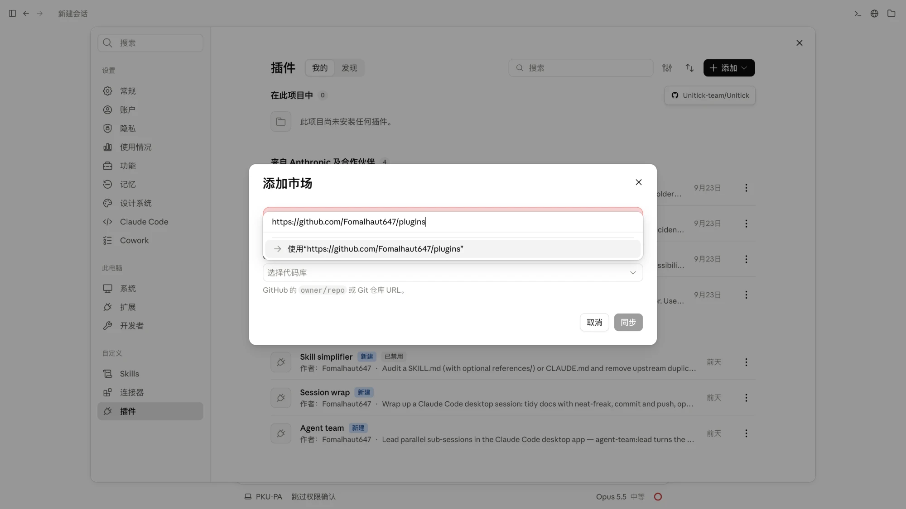

> [English version](README.en.md)

# fomalhaut647-plugins

我个人的 Claude Code plugins marketplace。

## 安装

### 在 Claude 桌面端

打开「设置 → 插件」，点右上角「添加」，选择添加市场，填入 `Fomalhaut647/plugins`（或完整 URL `https://github.com/Fomalhaut647/plugins`），点「同步」。同步完成后，本仓库的 plugin 会出现在插件列表里，逐个启用即可。



### 在 Claude Code CLI

```
/plugin marketplace add Fomalhaut647/plugins
```

之后可以在 `/plugin > Discover` 里浏览，或直接安装某个 plugin：

```
/plugin install <plugin-name>@fomalhaut647-plugins
```

## Plugins 列表

| 名字 | 状态 | 说明 |
| --- | --- | --- |
| [`agent-team`](plugins/agent-team) | v1.4.0 | 在 Claude Code 桌面端让当前会话当主会话，把工作拆给并行子会话，经一次性 `code-review` 审查会话把关，用户同意后合并成一个 PR |
| [`neat-freak`](plugins/neat-freak) | v3.0.0 | 会话结束后把项目文档、CLAUDE.md、Agent 记忆跟代码对齐，并审计规则执行情况；搬运自[数字生命卡兹克的 khazix-skills](https://github.com/KKKKhazix/khazix-skills) |
| [`session-wrap`](plugins/session-wrap) | v0.4.0 | 在 Claude Code 桌面端给会话收尾：整理文档、收齐子会话的改动后提交推送、开 PR 等 CI 后合并、关闭修复的 issue、归档会话，可选合并前 `code-review` 审查 |
| [`skill-simplifier`](plugins/skill-simplifier) | v0.2.1 | 审查 SKILL.md / CLAUDE.md，删除上游重复和全新会话模型本不会犯的假想防错 |

## 目录结构

```
.
├── .claude-plugin/
│   └── marketplace.json    # marketplace 索引
├── docs/images/            # README 用到的截图
├── LICENSE                 # 适用于本 marketplace 及自家 plugin
└── plugins/
    └── <plugin-name>/
        ├── .claude-plugin/plugin.json
        ├── skills/             # 或 commands/ / agents/
        ├── README.md           # 中文（双语主版本）
        ├── README.en.md        # 英文镜像
        ├── CLAUDE.md           # plugin 自己的贡献者指南
        └── RELEASE-NOTES.md
```

每个 plugin 还可选 `.mcp.json` 等附加文件。完整 schema 见 [官方 plugin 文档](https://code.claude.com/docs/en/plugins)。

## 许可证

[MIT](LICENSE) —— 适用于本 marketplace 及所有自家 plugin。`neat-freak` 是第三方作品，沿用其原作者的 MIT 许可证，见 [plugins/neat-freak/LICENSE](plugins/neat-freak/LICENSE)。
